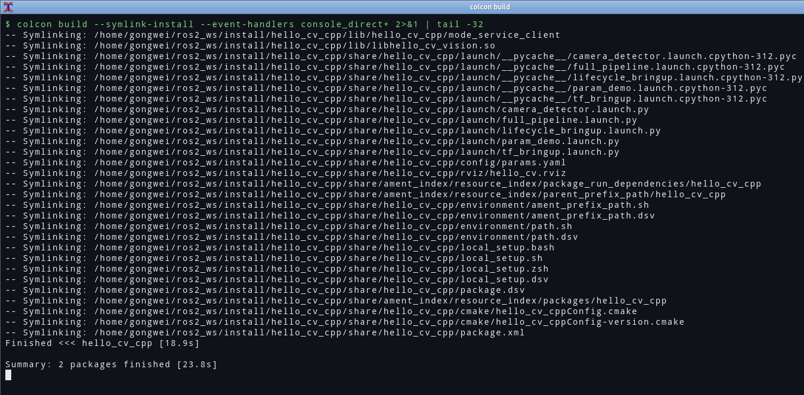
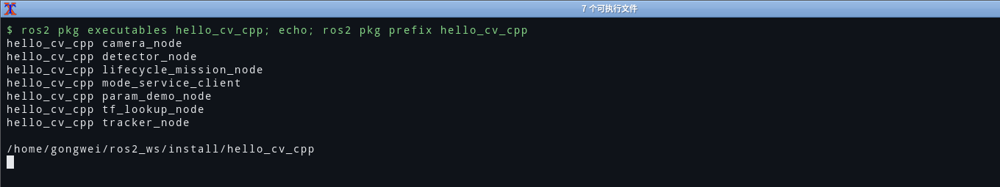

# 01 从零理解 ros2_ws：工作空间、两个包、以及 CMakeLists 到底在写什么

> **环境与验证状态**：本文的包结构、`package.xml`、`CMakeLists.txt` 都在
> Ubuntu 22.04.5 + ROS 2 Humble 上**真机编译、真机运行**过（2026-10-24，工作空间 `~/ros2_ws`）。
> `colcon build` 与 `ros2 pkg executables` 两段是实测截图；编译期真踩到的两个坑
> （缺 `include_directories`、`.so` 混进可执行目录）见文末「真机踩坑」。

## 0. 一句话总结

ROS2 的一个**包（package）**= 一份 `package.xml`（我是谁、依赖谁）+ 一份 `CMakeLists.txt`（怎么编、编出什么、
装到哪）；一堆包放在 `src/` 下，`colcon build` 把它们编到 `build/`、装到 `install/`，然后
`source install/setup.bash` 让 `ros2 run` 能按名字找到它们。

一句话记住三件事：**包名在 package.xml 里**、**可执行文件装到 `lib/<包名>/`**、**`ros2 run <包名> <可执行名>` 靠这两样对上号**。

## 1. 概念对照表（我自己的理解）

| 概念 | 我的理解 | 在本项目里的具体样子 |
| --- | --- | --- |
| 工作空间 workspace | 一个"工程根目录"，里面固定有 `src/`，编译后长出 `build/ install/ log/` | `ros2_ws/` |
| 包 package | 能被 `colcon` 识别、能被 `ros2 run` 找到的最小发布单元 | `hello_cv_interfaces`、`hello_cv_cpp` |
| 构建类型 | 决定"用什么工具编"：`ament_cmake`（C/C++）还是 `ament_python`（Python） | 两个包都是 `ament_cmake` |
| colcon | 构建工具，本身不认识 ROS，只按"包"并行调用各自的构建系统 | `colcon build --symlink-install` |
| install 空间 | 编译产物的"假根目录"，`source install/setup.bash` 后它才进 `AMENT_PREFIX_PATH` | `install/hello_cv_cpp/lib/hello_cv_cpp/camera_node` |
| 接口包 | 只放 `.msg/.srv`，不写逻辑；它的价值是**让依赖方不必重编实现** | `hello_cv_interfaces` |

## 2. 目录长什么样

```text
ros2/ros2_ws/
├── src/                                   # 只有这里是我的代码，其余都是生成物
│   ├── hello_cv_interfaces/               # 接口包：只有消息/服务定义
│   │   ├── msg/Detection.msg
│   │   ├── srv/SetTrackingMode.srv
│   │   ├── CMakeLists.txt
│   │   └── package.xml
│   └── hello_cv_cpp/                      # 实现包：节点、launch、参数、rviz
│       ├── include/hello_cv_cpp/*.hpp
│       ├── src/*.cpp
│       ├── launch/*.launch.py
│       ├── config/params.yaml
│       ├── rviz/hello_cv.rviz
│       ├── test/test_vision.cpp
│       ├── CMakeLists.txt
│       └── package.xml
├── build/                                 # colcon 生成：中间文件
├── install/                               # colcon 生成：最终产物（被 source 的那个）
└── log/                                   # colcon 生成：每次构建的日志
```

`build/ install/ log/` **不该进 git**（本仓库 `.gitignore` 已忽略）。判断一个目录是不是"生成物"，
有个很土但可靠的办法：删掉它能不能靠一条命令重建？能，就是生成物。

## 3. 两个包，两种 package.xml

### 3.1 接口包 `hello_cv_interfaces/package.xml`

```xml
<package format="3">
  <name>hello_cv_interfaces</name>
  <version>0.1.0</version>
  <description>HelloCV 视觉流水线的消息与服务定义（只有接口，没有实现）</description>
  <maintainer email="hitxxxx@example.com">HelloCV</maintainer>
  <license>MIT</license>

  <buildtool_depend>ament_cmake</buildtool_depend>
  <buildtool_depend>rosidl_default_generators</buildtool_depend>  <!-- 生成 C++ 头文件 -->
  <exec_depend>rosidl_default_runtime</exec_depend>                <!-- 运行时反序列化 -->
  <depend>std_msgs</depend>

  <!-- 关键一行：告诉 colcon/rosidl "我是接口包"，否则生成的代码不会被别的包看到 -->
  <member_of_group>rosidl_interface_packages</member_of_group>

  <export><build_type>ament_cmake</build_type></export>
</package>
```

三个容易漏的点：

1. `rosidl_default_generators` 是 **buildtool**（只在编译期用），`rosidl_default_runtime` 是 **exec**（运行时用），
   写混了 `rosdep` 检查就会报错。
2. `<member_of_group>rosidl_interface_packages</member_of_group>` 不加，接口包照样能编，
   但**别的包 `#include` 不到生成的头文件**——这个坑报错信息很不直观。
3. 接口包里**不要**写 `<depend>rclcpp</depend>`。接口不依赖任何客户端库，这是它存在的意义。

### 3.2 实现包 `hello_cv_cpp/package.xml` 的依赖段

```xml
<depend>rclcpp</depend>
<depend>rclcpp_lifecycle</depend>          <!-- 只给 lifecycle_mission_node 用 -->
<depend>rcl_interfaces</depend>
<depend>std_msgs</depend>
<depend>sensor_msgs</depend>
<depend>geometry_msgs</depend>
<depend>visualization_msgs</depend>        <!-- RViz Marker -->
<depend>tf2</depend>
<depend>tf2_ros</depend>
<depend>hello_cv_interfaces</depend>       <!-- 依赖自己写的接口包 -->

<exec_depend>ros2launch</exec_depend>      <!-- ros2 launch 命令 -->
<exec_depend>rviz2</exec_depend>
<exec_depend>tf2_tools</exec_depend>       <!-- view_frames -->
```

`<depend>` 是 `<build_depend>`+`<build_export_depend>`+`<exec_depend>` 的简写。**只在编译期需要**的头文件
（比如 `hello_cv_interfaces` 的生成头）用 `depend` 也不会错，但把 `rviz2` 写成 `depend` 就不合适了——
它跟编译毫无关系，只是运行时要启动。

## 4. CMakeLists 到底在写什么

`hello_cv_cpp/CMakeLists.txt` 的骨架（删掉注释后的主干）：

```cmake
cmake_minimum_required(VERSION 3.8)
project(hello_cv_cpp)

if(NOT CMAKE_CXX_STANDARD)
  set(CMAKE_CXX_STANDARD 17)
endif()
add_compile_options(-Wall -Wextra -Wpedantic)   # 注意：故意不加 -Werror

find_package(ament_cmake REQUIRED)
find_package(rclcpp REQUIRED)
find_package(rclcpp_lifecycle REQUIRED)
find_package(std_msgs REQUIRED)
find_package(sensor_msgs REQUIRED)
find_package(geometry_msgs REQUIRED)
find_package(visualization_msgs REQUIRED)
find_package(tf2 REQUIRED)
find_package(tf2_ros REQUIRED)
find_package(hello_cv_interfaces REQUIRED)

# 1) 纯算法编成库，好让 test_vision 直接链它
add_library(hello_cv_vision SHARED src/vision_utils.cpp)
target_include_directories(hello_cv_vision PUBLIC
  $<BUILD_INTERFACE:${CMAKE_CURRENT_SOURCE_DIR}/include>
  $<INSTALL_INTERFACE:include>)

# 2) 每个节点一个可执行文件
add_executable(camera_node src/camera_node.cpp)
ament_target_dependencies(camera_node rclcpp sensor_msgs hello_cv_interfaces)
# ... 其余 6 个同理 ...

# 3) 装到 lib/<包名>/ —— 这是 ros2 run 能找到它的唯一位置
install(TARGETS
  camera_node detector_node tracker_node tf_lookup_node
  param_demo_node lifecycle_mission_node mode_service_client
  DESTINATION lib/${PROJECT_NAME})

# 4) launch / 参数 / rviz 属于"运行时资源"，装到 share/<包名>/
install(DIRECTORY launch config rviz DESTINATION share/${PROJECT_NAME})

ament_package()
```

四条必须记住的规则：

| 规则 | 写错了会怎样 |
| --- | --- |
| 可执行文件必须装到 `lib/${PROJECT_NAME}` | `ros2 run` 报 `No executable found`，但文件明明在 `install/` 里另一个目录躺着 |
| 资源目录装到 `share/${PROJECT_NAME}` | `FindPackageShare('hello_cv_cpp')` 拿到空路径，launch 里读 YAML/launch 嵌套全崩 |
| **`ament_package()` 必须是最后一行** | 报 `ament_package() cannot be called more than once`，或者 `install` 目录里没有 `package.xml` |
| 接口包用 `rosidl_generate_interfaces()` 而不是 `add_library` | 头文件不生成，`#include "hello_cv_interfaces/msg/detection.hpp"` 找不到 |

接口包的 CMakeLists 核心就三行：

```cmake
find_package(rosidl_default_generators REQUIRED)
rosidl_generate_interfaces(${PROJECT_NAME}
  "msg/Detection.msg"
  "srv/SetTrackingMode.srv"
  DEPENDENCIES std_msgs)
ament_export_dependencies(rosidl_default_runtime)
```

## 5. 编译与运行

```bash
# 一次性：装依赖（Ubuntu 22.04 + Humble）
sudo rosdep init && rosdep update
cd ros2_ws
rosdep install --from-paths src --ignore-src -r -y

# 每次都做：编译
colcon build --symlink-install --event-handlers console_direct+

# 每次开新终端都要做：让当前 shell 认识这个工作空间
source install/setup.bash
```

`--symlink-install` 的意义：`install/` 里的 launch/python 文件是**符号链接**，改完不用重编，直接生效。
C++ 源码不行，仍然要重编。

一次干净的构建应该看到（Humble + colcon 的典型输出）：

```text
Starting >>> hello_cv_interfaces
Finished <<< hello_cv_interfaces [12.3s]
Starting >>> hello_cv_cpp
Finished <<< hello_cv_cpp [24.1s]

Summary: 2 packages finished [36.8s]
```


> 复现命令：`cd ros2/ros2_ws && colcon build --symlink-install`。

自检四连（少了任何一条都是"没装好"）：

```bash
ros2 pkg list | grep hello_cv            # 两个包都在
ros2 pkg prefix hello_cv_cpp             # 打印 install/hello_cv_cpp
ros2 interface show hello_cv_interfaces/msg/Detection
ros2 pkg executables hello_cv_cpp        # 7 个可执行文件
```

`ros2 pkg executables hello_cv_cpp` 的输出应该正好 7 行：

```text
hello_cv_cpp camera_node
hello_cv_cpp detector_node
hello_cv_cpp lifecycle_mission_node
hello_cv_cpp mode_service_client
hello_cv_cpp param_demo_node
hello_cv_cpp tf_lookup_node
hello_cv_cpp tracker_node
```



## 6. 我踩到的 / 差点踩到的坑

### 6.1 `source` 的层级写错

`source install/setup.bash` 和 `source /opt/ros/humble/setup.bash` 是**两层**，都要 source，且**顺序不能反**：

```bash
source /opt/ros/humble/setup.bash
source install/setup.bash          # 必须后 source，否则工作空间被系统 ROS 覆盖
```

反过来写，`ros2 pkg list` 里就找不到自己的包。这个错误的报错是 `Package 'hello_cv_cpp' not found`，
看起来像"没编成功"，其实是"没 source 对"。

### 6.2 改了 `.msg` 只编了实现包

`colcon build --packages-select hello_cv_cpp` 不会重编接口包，结果是**旧的头文件 + 新的实现**，
运行时字段对不上、反序列化直接崩。改消息后必须：

```bash
colcon build --packages-select hello_cv_interfaces hello_cv_cpp
```

### 6.3 在 `src/` 外面执行 `colcon build`

`colcon build` 必须在**工作空间根**（有 `src/` 的那层）执行。在 `src/hello_cv_cpp/` 里执行，
它会把这个单包当成一个工作空间编，产物散落在包目录里，`ros2 run` 依然找不到。

### 6.4 为什么我把接口单独拆一个包

一开始我图省事，想把 `.msg` 直接塞进 `hello_cv_cpp`。想了一下没这么干，理由是**依赖方向**：
将来如果写一个 Python 的调试工具，它只需要 `hello_cv_interfaces`，不该被迫依赖 C++ 实现包（更不该被
`rclcpp` 拖进来）。拆开之后，改实现不会触发接口包重编，改接口才触发——这个边界在工程上省时间。

这算是我对这个任务"项目结构"这一项的个人理解：**包不是按"文件多少"拆的，是按"谁会独立依赖它"拆的。**

## 7.5 真机踩坑：两个"只有真编译才会暴露"的问题

### 7.5.1 `CMakeLists.txt` 少了 `include_directories(include)`

第一次 `colcon build` 直接红：

```
fatal error: hello_cv_cpp/camera_node.hpp: 没有那个文件或目录
```

一开始我以为是把 `include/` 写错了，后来才想明白：我只有 `hello_cv_vision` 这个库用
`target_include_directories(... PUBLIC $<BUILD_INTERFACE:${CMAKE_CURRENT_SOURCE_DIR}/include>)`
把路径"传播"出去了，而 `camera_node`、`tf_lookup_node`、`param_demo_node`、
`lifecycle_mission_node`、`mode_service_client` 这五个可执行文件**根本不链接那个库**，
自然也就继承不到它的 PUBLIC include 路径。

修法是在 `find_package(hello_cv_interfaces REQUIRED)` 之后加一行：

```cmake
include_directories(include)   # 让所有目标都能 #include "hello_cv_cpp/xxx.hpp"
```

> 教训：`target_include_directories` 的 PUBLIC 只对**链接了这个 target 的人**生效；
> 一个工程里只要有一个目标没链接它，"局部生效"就会变成"局部编译失败"。
> 这类问题在只读代码时几乎不可能发现，因为头文件名字看起来是对的。

### 7.5.2 SHARED 库被装进了可执行文件目录

`ros2 pkg executables hello_cv_cpp` 一开始输出 **8 行**，最后一行是：

```
hello_cv_cpp libhello_cv_vision.so
```

原因是我图省事，把所有 target 一起写进了 `install(TARGETS ... DESTINATION lib/${PROJECT_NAME})`，
于是 SHARED 库也被扔进了 `lib/hello_cv_cpp/`，而 `ros2 pkg executables` 会把那个目录下的
**所有文件**都当可执行文件列出来。

修法是分开装：

```cmake
install(TARGETS camera_node detector_node tracker_node tf_lookup_node
                param_demo_node lifecycle_mission_node mode_service_client
        DESTINATION lib/${PROJECT_NAME})
install(TARGETS hello_cv_vision
        ARCHIVE DESTINATION lib
        LIBRARY DESTINATION lib
        RUNTIME DESTINATION bin)
```

改完正好 7 行——`ros2 pkg executables` 的行数本身就是一条可验证的断言。

## 7. 验收清单

- [x] `src/` 下两个包，各自有 `package.xml`（format 3）与 `CMakeLists.txt`
- [x] 接口包带 `rosidl_interface_packages` 组声明
- [x] 7 个可执行文件都 `install(TARGETS ... DESTINATION lib/${PROJECT_NAME})`
- [x] `launch/ config/ rviz/` 都装到 `share/${PROJECT_NAME}`
- [x] `.gitignore` 忽略 `build/ install/ log/`
- [x] 在真机 Humble 上 `colcon build` 通过（真机已验证）
