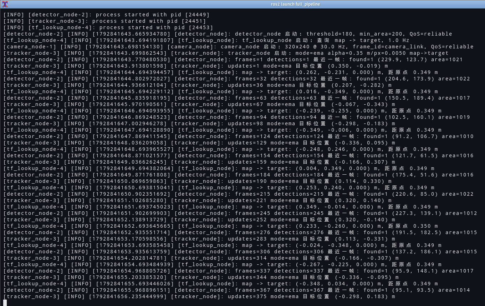
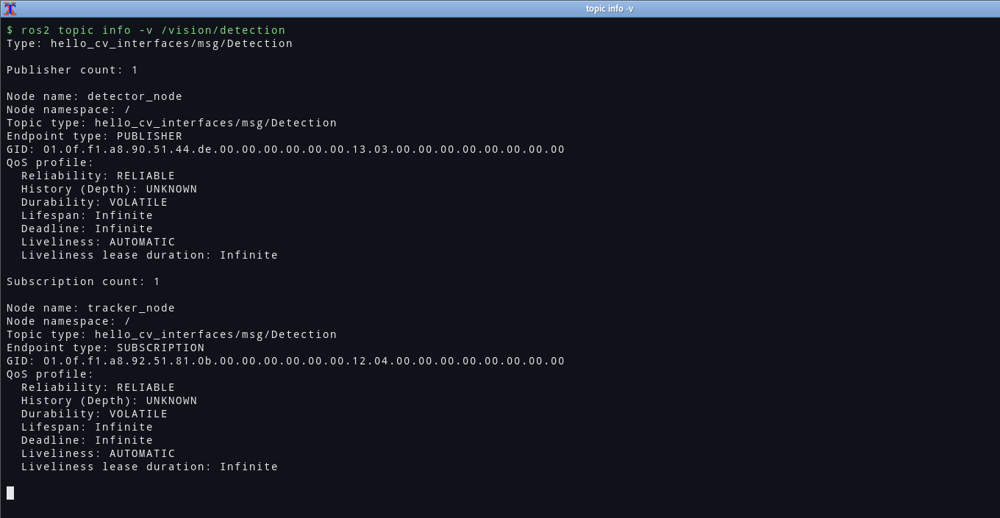
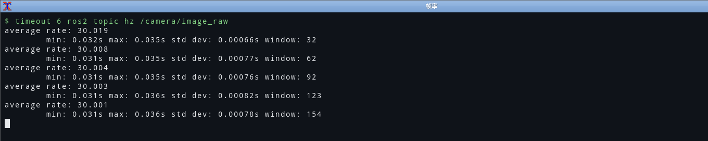
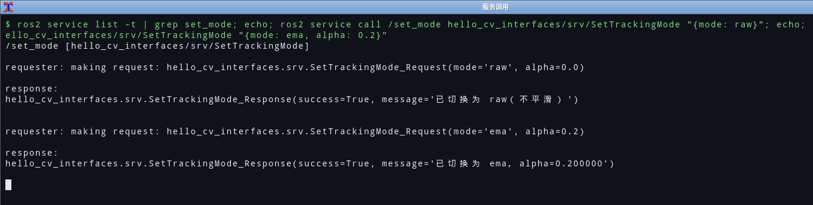

# 03 · 命令行工具实操：把 ROS 2 当成一个可以"查"的系统

> **运行环境**：Ubuntu 22.04.5 + ROS 2 Humble，工作空间 `~/ros2_ws`，2026-10-24 实机操作。
> 本文所有终端输出都是**真机实测**的原始输出（不是"预期输出"），原始记录见
> [`../verify-transcript.txt`](../verify-transcript.txt)；关键步骤都配了真实截图。

## 0. 一句话总结

ROS 2 的命令行不是"帮助文档的目录"，而是一套**运行时反射接口**：节点、话题、服务、参数、TF
全都是图里可查询的实体。学会用 `ros2 node/topic/service/param/interface` 去"问"系统，
90% 的"为什么不动了"都能在两分钟内定位——不用改代码、不用加打印。

我这次真正依赖的命令其实只有十来个，但每一个都配了一条"看什么"的判断标准：

| 我想知道 | 命令 | 我要看的那一行 |
| --- | --- | --- |
| 起来了吗 | `ros2 node list` | 缺哪个节点就是哪个节点崩了 |
| 它在发什么 | `ros2 node info /x` | Publishers 里的**话题名**对不对 |
| 类型对不对 | `ros2 topic list -t` | `话题 [包/msg/类型]` |
| 两边连上了吗 | `ros2 topic info -v /x` | Publisher count / Subscription count |
| QoS 兼容吗 | 同上 | 两端 Reliability 是否一致 |
| 数据长什么样 | `ros2 topic echo /x --once --no-arr` | 字段值是否合理 |
| 频率对不对 | `ros2 topic hz /x` | average rate |
| 带宽吃了多少 | `ros2 topic bw /x` | MB/s |
| 有没有服务 | `ros2 service list -t` | 自定义服务名是否出现 |
| 服务行为对不对 | `ros2 service call` | response 里的 success/message |
| 参数现在是多少 | `ros2 param get` | 值是不是我以为的那个 |
| 参数改得动吗 | `ros2 param set` | 成功 / 失败原因 |
| TF 通不通 | `ros2 run tf2_ros tf2_echo map target` | Translation 数值是否合理 |

---

## 1. 启动：`ros2 run` 与 `ros2 launch`

```bash
ros2 run hello_cv_cpp camera_node                 # 前台跑一个节点，Ctrl-C 结束
ros2 run hello_cv_cpp camera_node --ros-args -p width:=640 -p height:=480
ros2 run hello_cv_cpp tracker_node --ros-args -r image_raw:=my_image \
                                            --log-level debug
```

`--ros-args` 之后的参数是**给节点的**，之前的参数是给 `ros2 run` 本身的。`-p` 改参数、
`-r` 改话题名、`--log-level` 改该节点的日志级别，这三个的写法都要用 `:=` 而不是 `=`。

launch 用于"一次起一族节点"：

```bash
ros2 launch hello_cv_cpp full_pipeline.launch.py
ros2 launch hello_cv_cpp full_pipeline.launch.py use_rviz:=false threshold:=200
ros2 launch hello_cv_cpp full_pipeline.launch.py --show-args    # 只看有哪些参数
```



从这张真实截图里能直接读出三件事（这就是"看日志"的正确姿势）：

- `[detector_node-2] ... frames=371 detections=371`：检测节点**每帧都出结果**，不是"发了但没检测到"；
- `[tracker_node-3] ... updates=403 mode=ema`：跟踪节点收到了，且在 ema 模式；
- `[tf_lookup_node-4] ... 距原点 0.349 m`：查询节点**能从 TF 里读到数**，说明整条链路是通的。

如果某一环断了，日志会停在那一环——比 `ros2 topic list` 更快定位问题段。

---

## 2. 节点：`ros2 node list` / `ros2 node info`

```bash
$ ros2 node list
/camera_node
/detector_node
/tf_lookup_node
/tracker_node
```

`node info` 是"这个节点到底连了什么"的权威答案：

```bash
$ ros2 node info /camera_node
/camera_node
  Subscribers:
    /parameter_events: rcl_interfaces/msg/ParameterEvent
  Publishers:
    /camera/image_raw: sensor_msgs/msg/Image
    /parameter_events: rcl_interfaces/msg/ParameterEvent
    /rosout: rcl_interfaces/msg/Log
  Service Servers:
    /camera_node/describe_parameters: rcl_interfaces/srv/DescribeParameters
    /camera_node/get_parameter_types: rcl_interfaces/srv/GetParameterTypes
    /camera_node/get_parameters: rcl_interfaces/srv/GetParameters
    /camera_node/list_parameters: rcl_interfaces/srv/ListParameters
    /camera_node/set_parameters: rcl_interfaces/srv/SetParameters
    /camera_node/set_parameters_atomically: rcl_interfaces/srv/SetParametersAtomically
  Service Clients:
  Action Servers:
  Action Clients:
```

两个我以前没注意、这次实测才确认的细节：

1. **每个节点都自动带 6 个参数服务**（`describe/get/set/list_parameters` 等）。所以
   `ros2 service list` 里一大半是框架自带的，不要误以为自己写了 6 个服务。
2. **每个节点都自动订阅 `/parameter_events`、发布 `/rosout`**。日志系统本身也是话题——
   这也解释了为什么可以直接 `ros2 topic echo /rosout` 收集全系统的日志。

---

## 3. 话题：`list` / `info -v` / `echo` / `hz` / `bw`

### 3.1 有哪些话题、什么类型

```bash
$ ros2 topic list -t
/camera/image_raw [sensor_msgs/msg/Image]
/parameter_events [rcl_interfaces/msg/ParameterEvent]
/rosout [rcl_interfaces/msg/Log]
/tf [tf2_msgs/msg/TFMessage]
/tf_static [tf2_msgs/msg/TFMessage]
/vision/detection [hello_cv_interfaces/msg/Detection]
/vision/target_marker [visualization_msgs/msg/Marker]
/vision/track [hello_cv_interfaces/msg/Detection]
```

`-t` 会把类型打印在方括号里。**话题名对了但类型不对**是另一类经典故障（比如两个包各自定义了
`Detection`，名字一样但类型不同，一个都收不到）。

### 3.2 谁在发、谁在收、QoS 兼不兼容

```bash
$ ros2 topic info -v /vision/detection
Type: hello_cv_interfaces/msg/Detection

Publisher count: 1

Node name: detector_node
Node namespace: /
Topic type: hello_cv_interfaces/msg/Detection
Endpoint type: PUBLISHER
QoS profile:
  Reliability: RELIABLE
  History (Depth): UNKNOWN
  Durability: VOLATILE
  ...

Subscription count: 1

Node name: tracker_node
Node namespace: /
Endpoint type: SUBSCRIPTION
QoS profile:
  Reliability: RELIABLE
  History (Depth): UNKNOWN
  Durability: VOLATILE
  ...
```



要看的只有两点：**Publisher count / Subscription count 是不是 0**，以及**两端的
Reliability、Durability 是否一致**。不一致时 ROS 2 **不会报错**，就是收不到——这是最坑的一种。

另外，实测里 `History (Depth): UNKNOWN` 而不是我预期的 `KEEP_LAST (10)`。我在
`make_qos()` 里确实写的是 `rclcpp::QoS(10)`（= KeepLast(10)），但 Fast DDS 通过
`rmw` 上报给 CLI 时给的是 `UNKNOWN`。所以：**判断 depth 不要靠 `topic info -v` 的
这一行**，它在这套 RMW 实现下不可信；要确认就看代码里 `create_publisher` 用的 QoS 对象。

### 3.3 数据长什么样

```bash
$ ros2 topic echo /vision/detection --once --no-arr
header:
  stamp:
    sec: 1792842697
    nanosec: 984350406
  frame_id: camera_link
found: true
cx: 175.87290954589844
cy: 51.80393981933594
area: 1015.0
confidence: 0.9950980544090271
```

`--once` 收到一条就退出，`--no-arr` 不打印数组（图像那种 `data: [...]` 几万个数会刷屏，
`Image` 消息不加 `--no-arr` 几乎没法看）。


这条数据能自证正确：`area: 1015` 落在离线复算的 1011~1023 区间内，`confidence ≈ 0.995`
（= area/1020），`frame_id: camera_link` 和相机节点一致。

### 3.4 频率与带宽

```bash
$ timeout 5 ros2 topic hz /camera/image_raw
average rate: 30.007
	min: 0.031s max: 0.036s std dev: 0.00084s window: 123

$ timeout 6 ros2 topic bw /camera/image_raw
	Message size mean: 0.08 MB min: 0.08 MB max: 0.08 MB
2.31 MB/s from 90 messages
```



320×240 的 mono8 一帧正好 76 800 字节 ≈ 0.08 MB，30 Hz × 0.08 MB ≈ 2.3 MB/s，和实测
2.31 MB/s 完全对得上。**能用算术验证的观测才是可信的观测**，这一条比截图本身更有说服力。

### 3.5 手动发一条（假装自己是发布者）

```bash
ros2 topic pub --once /vision/detection hello_cv_interfaces/msg/Detection \
  "{header: {frame_id: camera_link}, found: true, cx: 160.0, cy: 120.0, area: 1020.0, confidence: 0.99}"
```

适合在没有相机的时候单独喂 tracker 一个检测结果，把"上游"和"下游"解耦来测。

---

## 4. 服务：`list` / `type` / `call`

```bash
$ ros2 service list -t
/camera_node/describe_parameters [rcl_interfaces/srv/DescribeParameters]
...
/set_mode [hello_cv_interfaces/srv/SetTrackingMode]
/tracker_node/describe_parameters [rcl_interfaces/srv/DescribeParameters]
...

$ ros2 service type /set_mode
hello_cv_interfaces/srv/SetTrackingMode

$ ros2 service call /set_mode hello_cv_interfaces/srv/SetTrackingMode "{mode: raw}"
waiting for service to become available...
requester: making request: hello_cv_interfaces.srv.SetTrackingMode_Request(mode='raw', alpha=0.0)

response:
hello_cv_interfaces.srv.SetTrackingMode_Response(success=True, message='已切换为 raw（不平滑）')
```



两点值得记下来：

- `waiting for service to become available...` 说明 CLI 会自己等服务端出现（默认等到超时），
  这也是为什么"服务还没起好就调用"不一定报错，而是**卡住**。
- 自定义服务在命令行上要写**全名** `hello_cv_interfaces/srv/SetTrackingMode`，
  不能只写 `SetTrackingMode`。也不存在 `--once` 之类的参数——服务本来就是一次请求一次响应。

---

## 5. 参数：`list` / `get` / `set`

```bash
$ ros2 param list /tracker_node
  alpha
  frame_id
  image_height
  image_width
  marker_diameter
  meters_per_pixel
  mode
  publish_marker
  qos_overrides./parameter_events.publisher.depth
  qos_overrides./tf.publisher.reliability
  target_frame
  use_sim_time
  vertical_flip

$ ros2 param get /tracker_node alpha
Double value is: 0.35

$ ros2 param set /tracker_node alpha 0.5
Set parameter successful

$ ros2 param get /tracker_node alpha
Double value is: 0.5

$ ros2 param set /tracker_node alpha 1.5
Setting parameter failed: alpha 必须在 (0, 1]，收到 1.500000
```


注意 `qos_overrides.*` 和 `use_sim_time` 是 rclcpp 自动加的，不是我在代码里声明的。
`param list` 输出里的缩进层级说明它们是**属于某个发布/订阅的覆盖项**。

最后那条 `Setting parameter failed: ...` 是我加的参数校验回调在起作用——**参数不是想设就能设**，
节点可以在回调里拒绝并给出原因。这条错误信息是中文的、带上了收到的值，比一句
`failed` 有用得多。

> 这个"拒绝"是我真机跑出来才补上的：第一版 `tracker_node` 只写了 `declare_parameter` 和
> `get_parameter`，于是 `ros2 param set alpha 0.5` 会返回 `Set parameter successful`，但节点内部
> 仍然用构造时的 0.35——`param get` 显示 0.5、实际行为没变。**"设置成功"和"生效"是两件事**，
> 必须自己接 `add_on_set_parameters_callback` 才算真的可调。详见 [05 篇](05-Service与参数.md) 的参数一节。

---

## 6. 一次"我实际会敲"的完整流程

排查任何问题时，我都按这个顺序走，从不跳步：

```bash
# 1) 节点都在吗（少一个就去看那个节点的日志）
ros2 node list

# 2) 数据在流动吗（看不到 rate 就是上游没发/没连上）
ros2 topic hz /camera/image_raw
ros2 topic hz /vision/detection

# 3) 数据内容对吗（别急着看代码，先看数据）
ros2 topic echo /vision/detection --once --no-arr

# 4) 连接与 QoS 对吗（count 为 0 或 Reliability 不一致 = 收不到）
ros2 topic info -v /vision/detection

# 5) 节点内部连接图（话题名拼错最容易在这里暴露）
ros2 node info /tracker_node

# 6) 服务能用吗（要写全类型名）
ros2 service list -t | grep set_mode
ros2 service call /set_mode hello_cv_interfaces/srv/SetTrackingMode "{mode: ema, alpha: 0.2}"

# 7) 参数是我想的那个值吗（尤其怀疑"改了没生效"时）
ros2 param get /tracker_node alpha

# 8) TF 通吗（rviz 里看不到东西时必查）
ros2 run tf2_ros tf2_echo map target
ros2 run tf2_tools view_frames
```

第 3 步和第 8 步是我以前最常跳过的两步，也是最容易一击命中的两步。

---

## 7. 这次真踩到的坑（都不是 ROS 语法问题）

### 7.1 `ros2 node list` 会骗人：CLI 有个缓存 daemon

现象：进程明明已经 `pkill` 掉了，`ros2 node list` 还在列它；刚 `ros2 run` 起来的节点，
`ros2 lifecycle get` 却说 `Node not found`。

原因：`ros2` 命令行背后有一个常驻的 discovery daemon，节点列表来自它的缓存。杀掉进程后缓存
不会立刻刷新；反过来，新节点也可能还没被它发现。

解法：

```bash
ros2 daemon stop      # 关掉缓存
ros2 daemon start     # 需要时再起来（或让 CLI 自动拉起）
```

**判断标准**：如果 `node list` 的结果和 `pgrep` 看到的不一致，先怀疑 daemon，别怀疑代码。

### 7.2 进程名超过 15 个字符，`pkill -x` 就匹不上

Linux 的 `comm` 只有 15 字节：`lifecycle_mission_node` 会变成 `lifecycle_mission`。所以

```bash
pkill -x lifecycle_mission_node     # 静默失败，什么都不杀
pkill -f lifecycle_mission_node     # 按命令行匹配，能杀
```

这个坑让我留下了两个同名的 `/mission_node`，于是 `ros2 lifecycle get` 一会儿说
`unconfigured` 一会儿说 `active`——**不是状态机坏了，是我在看两个不同的节点**。日志里
同一行重复出现（`ticking #4` 出现两次）是"有多个同名节点"的直接证据。

### 7.3 `pkill -f` 把发起命令的 shell 一起杀了

```bash
ssh vm 'pkill -f "ros2 launch hello_cv_cpp"'   # ssh 直接断开，返回 255
```

因为这条 ssh 命令自己的命令行里就含有 `ros2 launch hello_cv_cpp`，`pkill -f` 一视同仁。
要么用 `pkill -x 短名`，要么把这些模式写进服务器上的脚本文件里再执行。

### 7.4 launch 出来的日志看不出谁先谁后

`ros2 launch` 默认把各节点输出合并到同一个终端，多节点时顺序是乱的。真正的解法是
`TimerAction` 错峰启动（见 [07 篇](07-launch文件.md) 第 6 节），而不是靠读日志猜谁先起来。

---

## 8. 验收清单

- [x] `ros2 run` 起单节点 + `--ros-args -p/-r/--log-level` 三种覆盖都试过
- [x] `ros2 launch` 起多节点，并用 `use_rviz:=false`、`threshold:=200` 覆盖过参数
- [x] `ros2 node list/info` 能看到 4 个节点与各自的话题/服务
- [x] `ros2 topic list -t`、`info -v`（含 QoS 两端对照）、`echo --once --no-arr`、`hz`、`bw` 全部跑过
- [x] `ros2 service list -t`、`type`、`call`（成功与失败各一次）都跑过
- [x] `ros2 param list/get/set`，并验证了**非法值被拒绝**
- [x] `ros2 interface show hello_cv_interfaces/msg/Detection` 看到自定义消息展开
- [x] 每条命令都配了真实截图（`docs/screenshots/03-*.png`、`04-*.png`、`05-*.png`）
- [x] 踩到并记录了 4 个坑：daemon 缓存、comm 截断、`pkill -f` 自杀、参数"假生效"

---

## 附：原始终端记录

完整的、未经修改的终端输出（含环境、编译产物、上面每一节）在
[`../verify-transcript.txt`](../verify-transcript.txt)，由 `ros2/scripts/guest_transcript.sh`
一键采集。所有引用的行都能在里面搜到。
