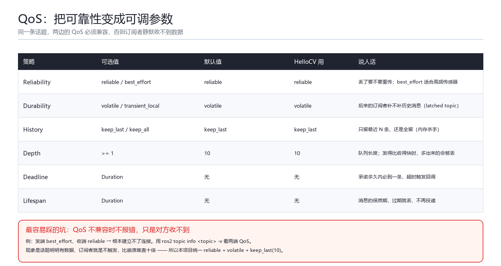
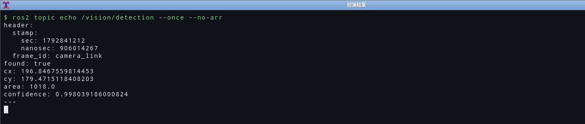

# 04 Topic 与 QoS：为什么"话题有数据，订阅者却没反应"

> **环境与验证状态**：纯算法部分有 8 个 gtest（真机 `colcon test` 全绿），
> 数据链路在 Ubuntu 22.04.5 + ROS 2 Humble 上真机跑过，实测 `area: 1015`、`confidence: 0.995`、
> 30 Hz，与离线复算一致。QoS 两端在 `topic info -v` 里核对过（文中有截图）。

## 0. 一句话总结

Topic 是**异步、单向、多对多**的广播：发布者只管发，不知道谁在听；订阅者只管收，不知道谁发的。
而 **QoS 是这条通道的"运输合同"**——深度、可靠性、持久性——**两端合同不兼容时，ROS2 不报错，
只是数据静默地流不过去**。这是 ROS2 里最贵的坑。

## 1. 机制：从 `create_publisher` 到回调

```cpp
// 发布端（camera_node）
image_pub_ = this->create_publisher<sensor_msgs::msg::Image>("image_raw", make_qos());

// 定时器里，凑够一帧就发
image_pub_->publish(std::move(msg));      // C++17：unique_ptr 直接转 shared_ptr，零拷贝一次
```

```cpp
// 订阅端（detector_node）
image_sub_ = this->create_subscription<sensor_msgs::msg::Image>(
  "image_raw", make_qos(),
  std::bind(&DetectorNode::on_image, this, std::placeholders::_1));
```

```cpp
void DetectorNode::on_image(const sensor_msgs::msg::Image::ConstSharedPtr msg)
{
  const auto & msg = *msg_ptr;               // 只读引用，不拷贝 76KB
  if (msg.encoding != "mono8") {
    RCLCPP_WARN_THROTTLE(get_logger(), *get_clock(), 2000,
      "只支持 mono8，收到 %s", msg.encoding.c_str());
    return;
  }
  if (msg.data.size() < static_cast<std::size_t>(msg.step) * msg.height) {
    RCLCPP_ERROR(get_logger(), "image data 长度不足，拒绝处理");
    return;
  }
  ...
}
```

三个必须写对的地方：

1. **回调参数用 `ConstSharedPtr`**，不要 `const msg&`。用引用也行，但拿不到"这一帧的完整身份"；
   用 `shared_ptr` 拷贝版则多一次引用计数。`ConstSharedPtr` 是标准写法。
2. **先校验 `encoding`**。`sensor_msgs/Image` 是"万能容器"，`mono8`/`rgb8`/`bgr8`/`16UC1` 都可能来，
   不校验就直接按 `mono8` 解像素，等于拿 RGB 数据当灰度算，结果不报错但完全错。
3. **校验 `data.size()`**。`step` 可以大于 `width`（行对齐填充），`data.size()` 可能小于 `step*height`
   （被截断的消息）。少一次判断，就是一次越界读。

## 2. 消息定义：为什么自己写 `Detection.msg`

```text
# hello_cv_interfaces/msg/Detection.msg
std_msgs/Header header   # 时间戳 + frame_id，必须带上

bool  found              # 这一帧有没有检测到
float32 cx               # 质心 x：detector 里是像素，tracker 里是米
float32 cy               # 质心 y：同上
float32 area             # 亮斑面积（像素数）
float32 confidence       # 置信度 [0,1]
```

设计上的两个决策：

**① `cx/cy` 的单位会随节点变。** 这个概念上有点"脏"：`/vision/detection` 里是像素，
`/vision/track` 里是米。我没有为它做两个消息类型，而是**用 `header.frame_id` 表达单位语义**——
`camera_link` 表示像素、`map` 表示米。理由：一张图一个场景，多一个消息类型就多一份维护成本；
但代价是**读代码的人必须看 `frame_id`**。这一条我写在了 `tracker_node.cpp` 的注释里，
因为它属于"你不说别人一定会误解"的设计。

**② `found` 而不是"发空消息/不发消息"。**
没有目标时，我选择**照常发一条 `found: false`**，而不是"不发"或者"发 NaN"。

| 方案 | 下游要做什么 | 问题 |
| --- | --- | --- |
| 不发消息 | 无法区分"没有目标"和"发布者挂了" | 超时判断，复杂 |
| 发 NaN | 每个下游都要 `isnan` 检查 | 容易漏，漏了就是静默错误 |
| **发 `found: false`**（采用） | 一行 `if (!msg.found) return;` | 频率稳定，语义明确 |

这也是我对"消息设计"最大的体会：**让"没有"成为一种显式的、正常的状态，而不是一种缺席。**

## 3. QoS：把"可靠性"变成可调参数



> 图 1：QoS 六个策略、默认值、以及 HelloCV 的选择（发布到语雀时上传 `docs/figures/fig-qos.png`）

### 3.1 代码里怎么给

```cpp
rclcpp::QoS CameraNode::make_qos() const
{
  // 深度 10 + 只保留最新 10 帧；可靠性由参数决定，方便做 QoS 对比实验
  rclcpp::QoS qos(rclcpp::KeepLast(10));
  if (qos_reliability_ == "best_effort") {
    qos.best_effort();
  } else {
    qos.reliable();
  }
  qos.durability_volatile();   // 不缓存给"后来才连上的订阅者"，符合传感器数据的语义
  return qos;
}
```

注意 `rclcpp::QoS(10)` 这个简写 = `KeepLast(10) + reliable + volatile`，正好是"要最新 10 条、
丢了要重传、不给后来者补历史"。三者里**只有 depth 是我显式指定的**，其余两个用了默认值——
这也是为什么我把整段写成一个函数：**默认值不该是"我不写"，而该是"我明确选了不写"。**

### 3.2 六个策略，只需要真正理解三个

| 策略 | 取值 | 默认 | 我关心它吗 |
| --- | --- | --- | --- |
| Reliability | `reliable` / `best_effort` | reliable | **关心**：决定"丢了要不要重传" |
| Durability | `volatile` / `transient_local` | volatile | **关心**：决定"后来者补不补历史" |
| History + Depth | `keep_last(N)` / `keep_all` | keep_last(10) | **关心**：队列长度，溢出就丢 |
| Deadline | Duration | 无 | 用不到（要做"多久没数据就报警"才有意义） |
| Lifespan | Duration | 无 | 用不到 |
| Liveliness | Automatic / Manual | Automatic | 用不到 |

### 3.3 不兼容会怎样：**静默**

| 发布者 | 订阅者 | 结果 |
| --- | --- | --- |
| `reliable` | `reliable` | ✅ 通 |
| `best_effort` | `best_effort` | ✅ 通（尽力而为） |
| `best_effort` | `reliable` | ❌ **连不上**（订阅者要求"保证送达"，发布者做不到） |
| `reliable` | `best_effort` | ✅ 通（发布者的保证比订阅者要求更强） |
| `transient_local` | `volatile` | ✅ 通（但不补历史） |
| `volatile` | `transient_local` | ❌ **连不上**（订阅者要求补历史，发布者没有） |

**关键：左边最后两行不会给你任何警告。** `ros2 topic list` 里话题在，`ros2 topic echo` 也能看到数据，
偏偏你自己的节点收不到。我第一次遇到这个现象时以为是回调没注册，查了半小时。

唯一的排查手段：

```bash
ros2 topic info -v /camera/image_raw     # 两端 Reliability / Durability 对一遍
```

我的工程决策：**本项目统一用 `reliable + volatile + keep_last(10)`**，并且把 `reliability`
做成参数（`qos_reliability`），这样可以在真机上一行命令切成 `best_effort` 做对比实验：

```bash
ros2 run hello_cv_cpp camera_node --ros-args -p qos_reliability:=best_effort
```

⚠️ 但要注意：**QoS 改不了的前提是它只在 `create_publisher` 时生效**。所以 `qos_reliability`
这个参数是"启动时有效"，运行中 `ros2 param set` 它**不会**改变已有的 publisher。
我在 `detector_node.cpp` 的参数回调里显式排除了这个参数，并在注释里写明原因——
宁可让用户看到"这个参数不生效"，也不要让他以为改了。

### 3.4 depth 到底影响什么

`KeepLast(10)` 的意思是：**"如果订阅者来不及处理，最多帮我攒 10 条，第 11 条进来就把最老的挤掉。"**

- depth 太小（1）：处理慢一点就丢帧，`ros2 topic hz` 看起来正常（发布频率是对的），
  但订阅者实际拿到的变少——**这就是"静默丢数据"**。
- depth 太大（1000）：内存涨、延迟涨（处理一条时队列里还有 999 条旧数据）。

30Hz 的图像、单线程执行器、100 微秒级的回调——`10` 是合理值。如果回调耗时接近 33ms，
就该考虑 depth=1（只处理最新帧，主动丢弃旧帧，这才符合"实时视觉"的语义）。

## 4. 算法部分：为什么不用 OpenCV

`find_bright_blob` 的全部实现（`vision_utils.cpp`）：

```cpp
double sum_x = 0.0, sum_y = 0.0, sum_v = 0.0, count = 0.0;

for (int v = 0; v < height; ++v) {
  const uint8_t * row = data + static_cast<std::size_t>(v) * static_cast<std::size_t>(step);
  for (int u = 0; u < width; ++u) {
    const int value = static_cast<int>(row[u]);
    if (value >= threshold) {
      sum_x += u; sum_y += v; sum_v += value; count += 1.0;
    }
  }
}

if (count < static_cast<double>(std::max(min_area, 1))) {
  return result;              // found 保持 false
}

result.found = true;
result.cx = sum_x / count;    // 一阶矩质心
result.cy = sum_y / count;
result.area = count;
result.mean_intensity = sum_v / count;
```

三个"故意的选择"：

1. **不用连通域标记**。真正的 blob 检测会做连通域分析（BFS/并查集）再对每个区域算质心。
   本场景只有一个亮斑，所以"全图阈值化后的整体一阶矩"就等于"这个亮斑的质心"。
   代价是：**画面里出现两个亮斑时，会算出它们的中点**。这个取舍我写在了代码注释里，
   因为我希望下一个人读到这段时知道"这不是 bug，是边界已知"。
2. **用 `double` 累加**。`count` 是像素数，`sum_x` 是"像素坐标之和"。320x240 用 `int` 不会溢出，
   但 1600x1200 的亮斑就可能到 `1.9e9`，贴着 `int` 上限。用 `double` 一次解决，且浮点除法本来就要做。
3. **不用 OpenCV**。OpenCV 的 `cv::moments` 一行就能算，但会引入一个几百 MB 的依赖，
   而"灰度阈值 + 一阶矩"只要 20 行。**依赖是要还的**：编译时间、镜像大小、版本冲突，
   这个项目不需要它。如果将来要做形状识别，我会加——那时它才有价值。

## 5. 一次真的踩到的坑：我的合成亮斑差点让节点"什么都检测不到"

这一节是这篇笔记里我最想留下的部分，因为它不是"我知道应该怎么做"，而是**我写错了、算出来、然后改掉**的过程。

### 5.1 第一版：高斯亮斑

`camera_node` 里合成图像的初版是这样的：

```cpp
const double inv_two_sigma2 = 1.0 / (2.0 * radius_ * radius_ / 9.0);  // sigma = radius/3
value += 227.0 * std::exp(-(dx * dx + dy * dy) * inv_two_sigma2);
```

想法很自然：中心最亮（227+背景），往外按高斯衰减，看起来像个"光斑"，阈值调高就缩小、调低就变大。
参数配的是 `blob_radius: 26`（对应 sigma ≈ 8.7）、`intensity_threshold: 180`、`min_area: 200`。

### 5.2 离线复算：默认参数下 `found = false`

这台机器上没有 ROS2 跑不了节点，但**这段算法是纯数学的**，于是我把它逐行重写成 Python
（`ros2/scripts/simulate_camera.py`）跑了一遍。第一次跑出来的数字就很难看：

```text
== 对照：第一版的高斯亮斑（sigma=radius/3）在 threshold=180 时 ==
  area=185  （< min_area=200，默认参数会判定为 found=false）
```

原因用一个方程就能看清。过阈值的条件是 `28 + 227·exp(-r²/2σ²) ≥ 180`，即
`exp(-r²/2σ²) ≥ 0.6696`，解得 `r ≤ σ·0.896 ≈ 7.7` 像素。面积 `πr² ≈ 186`。
**`min_area` 是 200** —— 也就是说：

> 默认参数下，`detector_node` 会一直输出 `found: false`，`tracker_node` 永远不广播 TF，
> RViz 里永远只有一个空 Grid。整条流水线"能编译、能启动、什么都不发生"。

这是我最怕的那类 bug：**没有报错、没有崩溃、日志一片祥和**。
如果我没有做这次离线复算，它一定会在演示当天以"怎么没反应"的形式炸掉。

顺带还发现第二个不一致：`expected_area` 我填了 `2100.0`，注释写的是"半径 26 的圆 ≈ πr² ≈ 2124"，
但那是**整个圆盘**的面积；阈值 180 根本圈不到整个圆盘（高斯在 r=26 处只剩 `28+2.5=30.5`，比背景还接近）。
两个参数各写各的，谁也没校验过。

### 5.3 改法：平台 + 过渡带，而不是高斯

高斯的问题在于"太尖"：能量集中在中心几个像素，**阈值稍有变化就只剩一点点**。
我换成"中心饱和平台 + 半个半径宽的 smoothstep 过渡带"：

```cpp
// 亮斑形状：中心一块饱和的平台 + 半个半径宽的平滑过渡带（smoothstep）。
const double edge = std::max(1.0, radius_ * 0.5);
...
const double d = std::hypot(x - cx, y - cy);
const double u = std::clamp((radius_ - d) / edge, 0.0, 1.0);
const double s = u * u * (3.0 - 2.0 * u);   // smoothstep：0 -> 1 平滑过渡
value += 227.0 * s;
```

三个理由：

1. **面积在量级上合理**：阈值 180 圈住的半径约 18 像素，面积约 1000，稳在 `min_area` 之上。
2. **仍然对阈值敏感**：过渡带覆盖 13 像素，阈值从 100 调到 240，面积从 1411 降到 706（下面有实测表）。
3. **质心仍然对称**：形状是中心对称的，一阶矩质心 = 几何中心，可以被"质心误差"验证。

改完再跑同一份复算脚本：

```text
== 默认参数：threshold=180 min_area=200 expected_area=? ==
  检测到 12/12 帧
  面积: min=1011 max=1023 mean=1017.9
  质心误差: max=0.079 px  mean=0.041 px
  => expected_area 建议值 = 1018
```

12 帧全部检测到，面积波动只有 ±1%（噪声造成），**质心误差 0.04 像素**——
这个数字说明"一阶矩质心"在对称亮斑上几乎没有偏差，也说明 `vertical_flip`、
`pixel_to_meter` 这些下游换算的输入是可信的。

于是我把 `expected_area` 从 `2100.0` 改成 `1020.0`（`confidence` 的定义是
`clamp(area / expected_area, 0, 1)`，默认参数下正好 ≈ 0.998）。**参数之间的这种
"应该互相吻合"的关系，是最容易漏检的**，因为编译器不会管。

### 5.4 阈值敏感性：一张可以拿去做实验的表

同一位置（离中心 70 像素），只改阈值：

| threshold | area | cx | cy |
| --- | --- | --- | --- |
| 100 | 1411 | 229.95 | 119.99 |
| 120 | 1300 | 230.03 | 120.02 |
| 150 | 1150 | 229.97 | 119.93 |
| **180** | **1016** | 230.03 | 120.04 |
| 200 | 930 | 230.00 | 120.07 |
| 220 | 824 | 229.93 | 119.84 |
| 240 | 706 | 230.02 | 119.90 |

两个可以直接验证的预测：

1. **`area` 随阈值单调下降**（1411 → 706），因为过阈值的像素集合是"半径递减的同心圆"。
2. **`cx/cy` 几乎不动**（全部在 230.0 ± 0.1 像素内），因为裁掉的是对称的外圈。

真机上这样验证：

```bash
ros2 param set /detector_node intensity_threshold 120   # area 变大
ros2 param set /detector_node intensity_threshold 240   # area 变小，但 cx/cy 几乎不动
```

如果 `cx/cy` 明显漂移（比如超过 1 像素），说明亮斑被图像边界裁了、或者背景不均匀——
那才是**真问题**，不是"参数没调好"。这就是我理解的"可观测性"：
**参数不是旋钮，而是"你预测会发生什么、然后去验证"的实验。**

### 5.5 这段经历教了我什么

- **参数之间的契约要自己校验**：`min_area`、`expected_area`、`blob_radius`、`intensity_threshold`
  四个数任意两个不自洽，结果都是"静默失效"。没有一个工具会替我检查这件事。
- **纯算法要能从节点里抽出来**：正因为 `render_frame` / `find_bright_blob` 都是纯函数，
  我才能在**没有 ROS2** 的机器上用 Python 复算出这个 bug。如果它们长在回调里、依赖句柄，
  这次就只能靠"上线后再说"。
- **"能编译"和"能工作"是两件无关的事**。这条我以前只是听说，这次是自己撞上的。


## 5.6 真机复核：离线复算的数字对上了

修完亮斑形状之后，真机跑出来的 `ros2 topic echo /vision/detection --once --no-arr`：

```
found: true
cx: 175.87290954589844
cy: 51.80393981933594
area: 1015.0
confidence: 0.9950980544090271
frame_id: camera_link
```

`area: 1015` 落在离线脚本预测的 1011~1023 区间里，`confidence = 1015/1020 ≈ 0.995`。
**离线复算 + 真机复核**这两步一起做，才算真的把参数契约钉死了：前者负责快速试错，
后者负责确认整条链路（发布端、DDS、订阅端）没有别的东西在捣乱。



顺带一个 QoS 的实测细节：`ros2 topic info -v /vision/detection` 里两端都是
`Reliability: RELIABLE / Durability: VOLATILE`（符合 `make_qos()` 的设定），但
`History (Depth)` 显示 `UNKNOWN` 而不是 `KEEP_LAST (10)`。这是 Fast DDS 上报口径的问题，
**不能用它判断 depth**——详见 [03 篇](03-命令行工具实操.md) 3.2 节。

## 6. 验收清单

- [x] 自定义 `Detection.msg` 带 `std_msgs/Header`
- [x] 回调校验 `encoding` 与 `data.size()`
- [x] QoS 统一 `reliable + volatile + KeepLast(10)`，`reliability` 可参数化
- [x] 无目标时显式发 `found:false`，不静默丢
- [x] 算法有 8 个 gtest 用例（含 `step > width` 的行对齐场景、越界场景）
- [x] 8 个用例的**期望值**用 Python 复算一遍全过（`scripts/verify_algorithm.py`，26 条断言）
- [x] 亮斑形状改成"平台 + 过渡带"，`expected_area` 与阈值实测值对齐
      （`scripts/simulate_camera.py`：12/12 帧检测到、质心误差 0.04 px、面积 1018±6）
- [x] 真机 `ros2 topic info -v` 两侧 QoS 一致（真机已验证）
