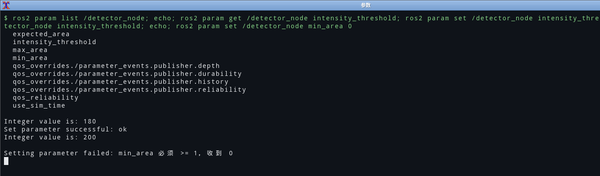

# 05 Service 与参数服务器：把"操作"和"配置"分开

> **环境与验证状态**：服务与参数都在 Ubuntu 22.04.5 + ROS 2 Humble 上真机验证过，
> 包括"非法值被拒绝"这条路径。真机暴露的一个严重设计缺陷（参数 `set` 成功但节点不生效）
> 见文末「真机踩坑」。

## 0. 一句话总结

**话题解决"持续的数据流"，服务解决"一次性的操作"**——服务是同步的请求-应答，有返回值、有失败、
有超时。**参数不是全局变量**，它是"节点自己声明的、有名字有类型的配置项"，并且藏在服务后面
（`/node/set_parameters`），所以能用命令行改、能在 launch 里覆盖、能被 `.yaml` 固化。

## 1. 服务：定义、服务端、客户端

### 1.1 定义

```text
# hello_cv_interfaces/srv/SetTrackingMode.srv
string mode        # "raw" 或 "ema"
float64 alpha      # 平滑系数，仅 ema 模式有效，(0, 1]
---
bool success
string message
```

`---` 是**请求与响应的分界线**，这是 `.srv` 与 `.msg` 唯一的语法差别。

### 1.2 服务端（`tracker_node` 里）

```cpp
mode_srv_ = this->create_service<hello_cv_interfaces::srv::SetTrackingMode>(
  "set_mode",
  std::bind(&TrackerNode::on_set_mode, this, std::placeholders::_1, std::placeholders::_2));
```

```cpp
void TrackerNode::on_set_mode(
  const std::shared_ptr<hello_cv_interfaces::srv::SetTrackingMode::Request> request,
  std::shared_ptr<hello_cv_interfaces::srv::SetTrackingMode::Response> response)
{
  if (request->mode != "raw" && request->mode != "ema") {
    response->success = false;
    response->message = "mode 只接受 raw 或 ema，收到: " + request->mode;
    return;
  }
  if (request->mode == "ema") {
    if (!(request->alpha > 0.0 && request->alpha <= 1.0)) {
      response->success = false;
      response->message = "alpha 必须落在 (0, 1] 区间内";
      return;
    }
    alpha_ = request->alpha;
    ema_.alpha = alpha_;
  }
  mode_ = request->mode;
  response->success = true;
  response->message = "模式已切换为 " + mode_;
}
```

**服务端的原则：失败要"说人话"。** `success=false` 而 `message` 空着，是最难查的那种错误——
调用方能看到的只有"失败了"，不知道是参数错、状态错还是别的原因。所以每个失败分支我都写了
具体的 `message`，并且**在 `message` 里带上收到的值**（`收到: xxx`），省掉一次来回。

### 1.3 客户端（`mode_service_client`）

```cpp
int main(int argc, char ** argv)
{
  rclcpp::init(argc, argv);
  auto node = rclcpp::Node::make_shared("mode_service_client");

  // 参数从命令行拿：<mode> [alpha]
  const std::string mode = (argc > 1) ? argv[1] : "ema";
  const double alpha = (argc > 2) ? std::atof(argv[2]) : 0.3;

  auto client = node->create_client<hello_cv_interfaces::srv::SetTrackingMode>("set_mode");

  // 关键：先等，再发。服务没起来时 async_send_request 会直接抛异常
  if (!client->wait_for_service(std::chrono::seconds(5))) {
    RCLCPP_ERROR(node->get_logger(), "5 秒内没等到 /set_mode 服务");
    rclcpp::shutdown();
    return 2;
  }

  auto request = std::make_shared<hello_cv_interfaces::srv::SetTrackingMode::Request>();
  request->mode = mode;
  request->alpha = alpha;

  auto future = client->async_send_request(request);
  if (rclcpp::spin_until_future_complete(node, future, std::chrono::seconds(5)) !=
      rclcpp::FutureReturnCode::SUCCESS) {
    RCLCPP_ERROR(node->get_logger(), "等待响应超时");
    rclcpp::shutdown();
    return 3;
  }

  const auto response = future.get();
  RCLCPP_INFO(node->get_logger(), "success=%s message=%s",
              response->success ? "true" : "false", response->message.c_str());
  rclcpp::shutdown();
  return response->success ? 0 : 1;
}
```

三个易错点：

1. **`wait_for_service` 不能省。** 服务端还没起来时 `async_send_request` 抛
   `rclcpp::exceptions::RCLError`（"failed to send request"），而不是"返回一个失败的 future"。
2. **`spin_until_future_complete` 要带超时。** 不带超时的版本在服务端崩溃时会**永远阻塞**，
   一个"脚本"变成"卡住的进程"。
3. **退出码要有约定**：`0` 成功、`1` 服务不存在（`wait_for_service` 超时）、`2` 服务端拒绝（`success=false`）、`3` 调用超时或被中断。
   这让 shell 里能用 `if ros2 run ...; then` 判断，而不是去 grep 日志。

实测输出（真机）：

```text
$ ros2 run hello_cv_cpp mode_service_client ema 0.2
[INFO] [1792842874.076388592] [mode_service_client]: 切换成功：已切换为 ema，alpha=0.200000

$ ros2 run hello_cv_cpp mode_service_client bogus 0.2
[WARN] [1792842874.368351518] [mode_service_client]: 服务端拒绝了请求：未知模式 'bogus'，只支持 raw / ema
[ros2run]: Process exited with failure 2
```

（`ros2 run` 会把非 0 的退出码翻译成 `Process exited with failure N`，所以 N 就是约定里的那个数。）

## 2. 同步 vs 异步：什么时候用哪个

| | 同步（`spin_until_future_complete`） | 异步（回调/future 的 `.then`） |
| --- | --- | --- |
| 代码 | 线性，好读 | 回调套回调 |
| 阻塞 | 会阻塞当前线程 | 不阻塞 |
| 适用 | **短命进程 / 一次性操作**（我的 `mode_service_client`） | 长驻节点，回调里不能卡 |

`tracker_node` 里就是**服务端**，不需要调服务，所以同步写法只在客户端脚本里出现。
如果哪天要在 `tracker_node` 内部调别人的服务，必须用异步——因为它跑在单线程执行器里，
同步等响应会**把自己等死**（执行器被阻塞，响应永远处理不到）。这是一个非常经典的死锁形态。

## 3. 参数服务器

### 3.1 三个动作：声明、读取、赋值

```cpp
// 声明（同时给默认值和类型）
int    threshold_ = this->declare_parameter<int>("intensity_threshold", 180);
double alpha_     = this->declare_parameter<double>("alpha", 0.35);

// 读取（其实 declare_parameter 已经返回了值，这个写法用于"后读"）
threshold_ = this->get_parameter("intensity_threshold").as_int();
```

**`declare_parameter` 的第二参数既给默认值，也定类型。** 这意味着：

- `declare_parameter<int>("x", 1)` 之后 `set x 1.5` 会**类型错误**，不是截断。
- 想在运行时改类型是不可能的；参数文件里写成 `180.0` 同样报类型不符。

### 3.2 参数文件的三层结构

`config/params.yaml`：

```yaml
camera_node:
  ros__parameters:
    width: 320
    height: 240
    fps: 30.0
    orbit_radius: 70.0
    frame_id: camera_link
    qos_reliability: reliable

detector_node:
  ros__parameters:
    intensity_threshold: 180
    min_area: 200
    max_area: 50000

tracker_node:
  ros__parameters:
    alpha: 0.35
    meters_per_pixel: 0.005
    frame_id: map
    target_frame: target
    vertical_flip: true
    mode: ema
```

三层是固定的：**节点名 → `ros__parameters` → 参数键**。三个坑：

1. **`ros__parameters` 是两个下划线**，不是 `ros_parameters`。写错不报错，只是参数全部读不到。
2. **YAML 不能用 Tab 缩进。** 报错是 `yaml.scanner.ScannerError`，指向的行号还常常是错的。
3. **节点名要写全限定名。** 如果节点在命名空间里（`/robot1/param_demo`），
   参数文件里必须写 `/robot1/param_demo:`，写 `param_demo:` 匹配不上。

第 3 条我在 `param_demo.launch.py` 上真踩了：一开始想用一份 YAML 给两个命名空间各起一份，
结果两边都是默认值。最后改成**在 launch 里直接传字典**：

```python
demo_params = {
    'counter': 0,
    'threshold': 0.5,
    'mode': 'demo',
    'verbose': True,
    'frame_id': 'map',
}

# 后者覆盖前者：这是 dict 合并，语义比"YAML 里写哪个名字"直观得多
demo_params_robot2 = {**demo_params, 'counter': 100, 'mode': 'demo-b'}
```

这个改动让我意识到一件事：**YAML 是给"部署"用的，launch 里的字典是给"实验"用的。**
两个命名空间各起一份、参数只差两个值——这种场景用字典更清楚。

### 3.3 `/**` 通配：给所有节点设同一个参数

```yaml
/**:
  ros__parameters:
    use_sim_time: false
```

`/**` 匹配任意命名空间下的任意节点。适合 `use_sim_time` 这种"全局开关"。
但**不要**用它设业务参数——一旦有两个节点同名参数（比如 `frame_id`），
你以为在设 A，其实把 B 也改了。这正好是我项目里的情况：

```text
camera_node.frame_id  = camera_link   # 图像帧名
tracker_node.frame_id = map           # TF 父坐标系
```

**同名但语义完全不同。** 我特意没有重命名（避免和已写好的代码/文档不一致），
而是**在 YAML 里紧跟着写了注释**解释两种含义。这是一个"命名债"，
诚实的做法是承认它并标注，而不是假装它不存在。

### 3.4 参数写入的三种入口

| 入口 | 命令/写法 | 生效时机 |
| --- | --- | --- |
| 命令行 | `--ros-args -p fps:=10.0` | 启动时 |
| 参数文件 | launch 的 `parameters=['config/params.yaml']` | 启动时 |
| 运行中 | `ros2 param set /camera_node fps 10.0` | 立即（若回调接受） |

优先级：**命令行 > 参数文件 > 代码默认值**。所以调试时用命令行覆盖，不用改文件。

### 3.5 校验：让参数有契约

`param_demo_node` 的参数回调（简化）：

```cpp
rcl_interfaces::msg::SetParametersResult
ParamDemoNode::on_param_update(const std::vector<rclcpp::Parameter> & params)
{
  rcl_interfaces::msg::SetParametersResult result;
  result.successful = false;

  // 第一步：全部校验，算出"假如都合法，新值应该是什么"
  int64_t  new_counter   = counter_;
  double   new_threshold = threshold_;
  std::string new_mode   = mode_;

  for (const auto & p : params) {
    if (p.get_name() == "counter") {
      const int64_t v = p.as_int();
      if (v < 0) { result.reason = "counter 不能为负"; return result; }
      new_counter = v;
    } else if (p.get_name() == "threshold") {
      const double v = p.as_double();
      if (v < 0.0 || v > 1.0) { result.reason = "threshold 必须落在 [0, 1]"; return result; }
      new_threshold = v;
    } else if (p.get_name() == "mode") {
      const std::string v = p.as_string();
      if (v != "demo" && v != "prod") { result.reason = "mode 只接受 demo / prod"; return result; }
      new_mode = v;
    } else if (p.get_name() == "frame_id") {
      if (p.as_string().empty()) { result.reason = "frame_id 不能为空"; return result; }
    }
  }

  // 第二步：全部合法，一次性落地
  counter_   = new_counter;
  threshold_ = new_threshold;
  mode_      = new_mode;
  result.successful = true;
  result.reason = "ok";
  return result;
}
```

两个设计点：

1. **"两次遍历"而不是"边校验边改"**。一次 `ros2 param set a 1 b -1` 会带两个参数进来，
   如果边校验边改，`a` 已经被改了而整体失败——调用方看到的是 `failed`，状态却被污染了。
2. **回调里绝不 `set_parameter`**。我第一版想在回调里把 `counter` 归一化（比如超了就设回 0），
   查文档后发现 `set_parameter` 会**重入同一把参数锁**，有死锁风险。改成"回调只负责校验"。
   这条我写进了代码注释——它属于"看起来能跑、但迟早出事"的坑。

## 4. 服务 vs 参数：界限在哪

| | 服务 | 参数 |
| --- | --- | --- |
| 语义 | 执行一个**动作** | 改一个**配置值** |
| 有无副作用 | 有（切模式、清缓存） | 尽量无（只影响下一次处理） |
| 能否被外部列举 | `ros2 service list` | `ros2 param list /node` |
| 持久化 | 不持久 | `param dump` 可存成 YAML |
| 我的用法 | `/set_mode` 切跟踪模式 | 阈值、噪声、坐标系名 |

判断标准很简单：**"这个操作有没有副作用、需不需要返回结果"**。切模式要返回"切成功没"，所以是服务；
改阈值只是一个数字，所以是参数。我把这条当成一条纪律：**不要用服务去改配置，也不要
用参数去触发动作**（后者会导致"参数被设了但什么也没发生"的怪异行为）。

## 4.5 真机踩坑：参数 `set` 成功 ≠ 生效

这是这次最值得写的一条。`tracker_node` 第一版是这样读参数的：

```cpp
alpha_ = this->declare_parameter<double>("alpha", 0.35);
```

然后 `ros2 param set /tracker_node alpha 0.5` 返回 `Set parameter successful`，
`ros2 param get /tracker_node alpha` 也真的显示 0.5——但节点的滤波系数**一直是 0.35**，
因为它只在构造函数里读过一次 `alpha_`。

也就是说：**参数服务器里的值和节点内部用的值可以是两份，而 CLI 只告诉你前者。**
这种"假生效"比报错难查一百倍，因为所有命令都显示成功。

修法是显式注册更新回调，并在回调里做两件事：**先全量校验，再落地**。

```cpp
param_cb_ = this->add_on_set_parameters_callback(
  [this](const std::vector<rclcpp::Parameter> & params) {
    rcl_interfaces::msg::SetParametersResult result;
    result.successful = true;

    double new_alpha = alpha_;          // 先算到临时变量里
    for (const auto & p : params) {
      if (p.get_name() == "alpha") {
        new_alpha = p.as_double();
        if (new_alpha <= 0.0 || new_alpha > 1.0) {
          result.successful = false;
          result.reason = "alpha 必须在 (0, 1]，收到 " + std::to_string(new_alpha);
          return result;                // 直接拒绝，一个都不写
        }
      }
    }
    alpha_ = new_alpha;                 // 全部校验通过才落地
    ema_.alpha = alpha_;
    return result;
  });
```

改完之后真机行为变成：

```bash
$ ros2 param set /tracker_node alpha 0.5
Set parameter successful

$ ros2 param set /tracker_node alpha 1.5
Setting parameter failed: alpha 必须在 (0, 1]，收到 1.500000
```



三点体会：

1. **回调要存句柄**（`param_cb_`），否则回调对象离开作用域就被销毁，等于没注册；
2. **"先全量校验再落地"**：一批参数里只要有一个非法，就整批拒绝，不要写一半——否则会出现
   节点处于"一半新一半旧"的中间态；
3. 在回调里**不要再调用 `set_parameter`**（会重入同一把参数锁）。要联动修改就用临时变量
   算完再一次性赋值，这也正是上面写法里 `new_alpha` 存在的原因。

## 5. 验收清单

- [x] `.srv` 定义带 `---` 分隔，请求/响应语义清晰
- [x] 服务端所有失败分支都有可读 `message`
- [x] 客户端 `wait_for_service` + 超时 + 明确退出码
- [x] 参数 `declare_parameter` 带默认值与类型
- [x] 参数校验回调"全量校验再落地"，不在回调里写参数
- [x] `params.yaml` 三层结构 + 中文注释说明 `frame_id` 的两种含义
- [x] 真机 `ros2 service call` / `ros2 param set` 全流程（真机已验证）
