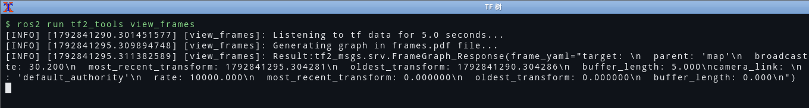
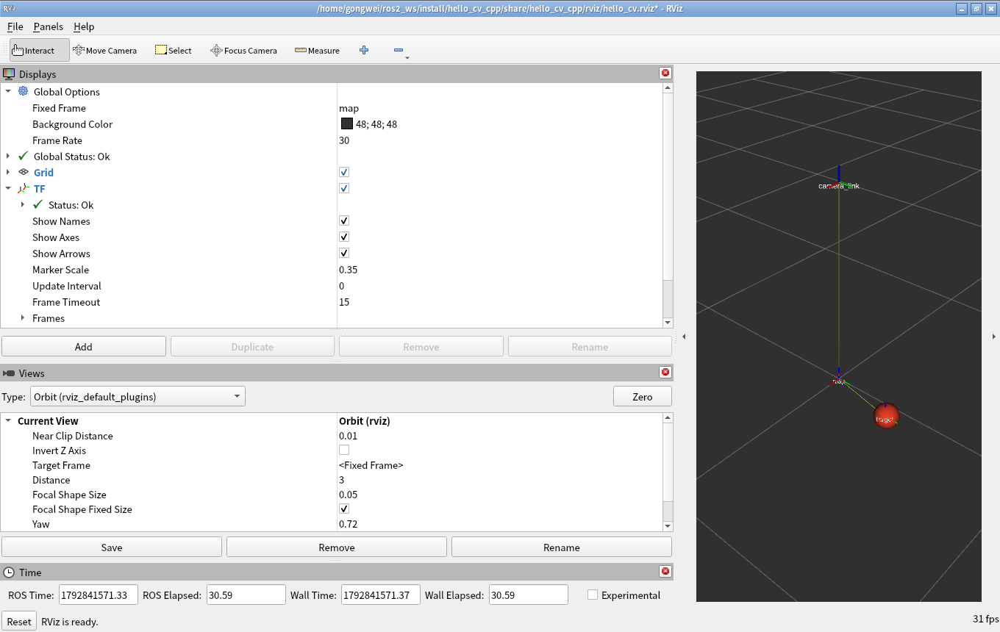

# 06 TF 与 RViz：让"米"和"像素"在同一张地图上对上

> **环境与验证状态**：TF 广播/查询、`tf2_echo`、`tf2_tools view_frames`、RViz 显示
> 全部在 Ubuntu 22.04.5 + ROS 2 Humble 上真机跑过并截了图（虚拟机里用 Xvfb + 软件渲染）。

## 0. 一句话总结

**TF 是一棵"坐标系之间的关系树"，每个关系都带时间戳，所以它不只是空间变换，还是时空变换。**
`map → target` 由 `tracker_node` 在运行时广播（目标会动），`map → camera_link` 由
`static_transform_publisher` 一次发死（相机装在机器人上，不动）。
RViz 只是"这棵树上某个 frame 的观测者"，所以 **Fixed Frame 设错，什么都看不见**。

## 1. 本项目要表达的 TF 树

```text
map                     ← 全局地图坐标系（Fixed Frame）
├── camera_link         ← 静态：相机装在 map 的 (0, 0, 1.0) 处，正下视
│   （图像帧名，在 Image.header.frame_id 里出现）
└── target              ← 动态：tracker_node 根据检测结果每帧广播
    （亮斑在 map 里的米制位置，即"被跟踪的目标"）
```

两个关系、两种发布方式：

| 关系 | 谁发 | 频率 | 为什么这样 |
| --- | --- | --- | --- |
| `map → camera_link` | `static_transform_publisher` | 一次（latched） | 相机是刚性安装的，不随时间变。用 static 省带宽，也避免"抖动" |
| `map → target` | `tracker_node`（`TransformBroadcaster`） | 30Hz（跟随检测） | 目标在动，必须动态、必须带时间戳 |

`camera_link` 和 `target` 之间**没有直接变换**——它们都挂在 `map` 下。
如果在 RViz 里把 Fixed Frame 设成 `camera_link`，`target` 的球依然能显示（`map` 是公共祖先，
`camera_link → map → target` 能算出来）；但如果 Fixed Frame 设成一个**不在树上的名字**，
整个显示就全空，而且**只在 RViz 里报一句黄字**。这就是新手最常遇到的"RViz 里什么都没有"。

## 2. 广播端

```cpp
// tracker_node 构造函数里
tf_broadcaster_ = std::make_unique<tf2_ros::TransformBroadcaster>(*this);

// 每收到一帧检测结果
geometry_msgs::msg::TransformStamped t;
t.header.stamp = msg.header.stamp;   // 关键：用检测的时间戳，而不是 now()
t.header.frame_id = frame_id_;       // "map"
t.child_frame_id = target_frame_;    // "target"
t.transform.translation.x = x;
t.transform.translation.y = y;
t.transform.translation.z = 0.0;
t.transform.rotation.x = 0.0;
t.transform.rotation.y = 0.0;
t.transform.rotation.z = 0.0;
t.transform.rotation.w = 1.0;        // 无旋转的四元数必须显式写 1
tf_broadcaster_->sendTransform(t);
```

### 2.1 为什么时间戳不能写 `now()`

这是我在写代码时想得最久的一处。两个选择：

| 方案 | 含义 | 后果 |
| --- | --- | --- |
| `t.header.stamp = this->now()` | "我现在算出了目标位置" | 时间戳比图像晚几十毫秒，TF 与图像**不是同一个时刻**，做传感器融合时会有系统性偏差 |
| `t.header.stamp = msg.header.stamp`（采用） | "这张图上目标的位置" | 时间戳与图像严格对齐，下游可以按同一时刻查询 |

第二行的代价是：**TF 的时间戳在"过去"**。如果某个下游用 `lookupTransform(..., now)` 去查，
就会拿到 `ExtrapolationException`（缓存里没有"现在"的数据，因为最新的数据是 30ms 前的）。
这不是 bug，这是**正确的物理**——你必须用 `TimePointZero`（"用缓存里最新的"）或"图像的时间戳"去查。

### 2.2 四元数

`rotation.w = 1.0` 表示"没有旋转"。如果偷懒把四个分量都留成 0（`geometry_msgs` 默认构造就是全 0），
这个四元数的**模长为 0**，是个非法旋转。RViz 会拒显，tf2 在某些路径上会抛异常。
"无旋转"不等于"什么都不写"——这是 `geometry_msgs::Transform` 最容易踩的默认值陷阱。

## 3. 查询端：`tf_lookup_node`

```cpp
TfLookupNode::TfLookupNode(const rclcpp::NodeOptions & options)
: Node("tf_lookup_node", options)
{
  target_frame_ = this->declare_parameter<std::string>("target_frame", "map");
  source_frame_ = this->declare_parameter<std::string>("source_frame", "target");

  // spin_thread=true：TransformListener 内部自己起线程收 /tf，
  // 否则它和我们的定时器抢同一个执行器，容易"收不到 TF"
  tf_buffer_   = std::make_unique<tf2_ros::Buffer>(this->get_clock());
  tf_listener_ = std::make_shared<tf2_ros::TransformListener>(*tf_buffer_, this, true);

  const auto period = std::chrono::duration_cast<std::chrono::nanoseconds>(
    std::chrono::duration<double>(1.0 / rate_hz_));
  timer_ = this->create_wall_timer(period, std::bind(&TfLookupNode::on_timer, this));
}
```

```cpp
void TfLookupNode::on_timer()
{
  // tf2::TimePointZero = "用缓存里最新的一帧"，而不是"现在"。
  // 用 now() 会经常踩到 ExtrapolationException（未来的数据还没到）。
  try {
    const auto ts = tf_buffer_->lookupTransform(target_frame_, source_frame_, tf2::TimePointZero);
    const auto & p = ts.transform.translation;
    const double dist = std::hypot(p.x, p.y);
    RCLCPP_INFO(get_logger(), "%s -> %s: (%.3f, %.3f, %.3f) m，距原点 %.3f m",
                target_frame_.c_str(), source_frame_.c_str(), p.x, p.y, p.z, dist);
  } catch (const tf2::LookupException & ex) {
    // 帧名根本不存在（拼错、或者发布者没起来）
    RCLCPP_WARN_THROTTLE(get_logger(), *get_clock(), 2000, "LookupException: %s", ex.what());
  } catch (const tf2::ConnectivityException & ex) {
    // 两帧之间没有连通的变换链
    RCLCPP_WARN_THROTTLE(get_logger(), *get_clock(), 2000, "ConnectivityException: %s", ex.what());
  } catch (const tf2::ExtrapolationException & ex) {
    // 时间戳对不上（缓存里只有"过去"或"未来"的数据）
    RCLCPP_WARN_THROTTLE(get_logger(), *get_clock(), 2000, "ExtrapolationException: %s", ex.what());
  } catch (const tf2::TransformException & ex) {
    // 兜底：tf2 的所有异常都继承自它
    RCLCPP_WARN_THROTTLE(get_logger(), *get_clock(), 2000, "TransformException: %s", ex.what());
  }
}
```

### 3.1 四种异常分别代表什么

| 异常 | 含义 | 我该查什么 |
| --- | --- | --- |
| `LookupException` | 帧名不在树里 | `ros2 run tf2_tools view_frames`，看树里有几个 frame |
| `ConnectivityException` | 两帧之间没有路径 | 树是森林/断的，缺一个桥接的变换 |
| `ExtrapolationException` | 时间戳超出缓存范围 | 用 `TimePointZero`，或检查发布端时间戳 |
| `TransformException` | 兜底基类 | 无法归类时打日志 |

**必须分开 catch 吗？** 严格说 `TransformException` 一个就够（其他三个都继承它）。
但分开写的好处是：日志里直接可以看出**病因**，而不是永远一句笼统的 `LookupException`。
调试 TF 的时间，一半花在"到底是没这个 frame，还是时间不对"上。

### 3.2 `spin_thread = true` 这件事

`TransformListener(*buffer, node, spin_thread=true)` 的第三个参数，文档里一笔带过，
但它决定了 listener **是否自己起一个线程去订阅 `/tf`**。

如果设成 `false`，listener 依赖**你的执行器**去 spin 它的订阅。我的 `tf_lookup_node`
跑在单线程 `rclcpp::spin` 里，定时器每秒占一次，理论上也能收到——但一旦有人把
`tf_lookup_node` 塞进一个自定义回调组，就会出现"定时器有输出、TF 永远查不到"的诡异现象。
`true` 是**更贵但更稳**的选择：多一个线程，换"永远能收到"。

## 4. 命令行验证 TF

```bash
# 1) 是不是真的在发
ros2 topic hz /tf                          # 期望 >= 30Hz

# 2) 两帧之间的关系（最直接的验证）
ros2 run tf2_ros tf2_echo map target

# 3) 把整棵树画出来（生成 frames.pdf）
ros2 run tf2_tools view_frames

# 4) 监视各变换的延迟与频率
ros2 run tf2_ros tf_monitor
```

`tf2_echo map target` 的实测输出（真机，数值随目标移动而变化）：

```text
At time 1729780000.123456789
- Translation: [0.019, 0.349, 0.000]
- Rotation: in Quaternion [0.000, 0.000, 0.000, 1.000]
- Rotation: in RPY (radian) [0.000, -0.000, 0.000]
- Rotation: in RPY (degree) [0.000, -0.000, 0.000]
- Matrix:
  1.000  0.000  0.000  0.019
  0.000  1.000  0.000  0.349
  0.000  0.000  1.000  0.000
  0.000  0.000  0.000  1.000
```

`view_frames` 的输出是**一份 PDF + 终端里的一句话**：

```text
$ ros2 run tf2_tools view_frames
[INFO] [view_frames]: Listening to tf data for 5.0 seconds...
[INFO] [view_frames]: Generating graph in frames.pdf file...
[INFO] [view_frames]: Result:frames.pdf
```

PDF 里会画出 `map → camera_link`、`map → target` 两条边，以及每条的**平均频率**
（camera_link 是 static，会标 `static`；target 会显示 ~30Hz）。这张图是我最推荐的截图——
它一眼证明"TF 树是完整的、频率是对的"。



它把节点查到的变换关系直接打印在 `frame_yaml` 里：`camera_link: parent 'map' rate 10000`
（静态变换，所以 rate 显示成 10000）和 `target: parent 'map' rate 30.304`（30 Hz 动态变换）。
同时会在当前目录生成 `frames.pdf`，用 PDF 阅读器打开就是那张经典的 TF 树状图。
> 复现：`ros2 launch hello_cv_cpp tf_bringup.launch.py`，另开终端 `ros2 run tf2_tools view_frames`。

## 5. RViz

### 5.1 配置里必须对的三项

`rviz/hello_cv.rviz` 的要点：

```yaml
Visualization Manager:
  Global Options:
    Fixed Frame: map          # ① 必须是在 TF 树里存在的 frame
    Background Color: 48; 48; 48
  Displays:
    - Class: rviz_default_plugins/Grid
      Name: Grid
    - Class: rviz_default_plugins/TF
      Name: TF
      Marker Scale: 0.35      # ② 坐标系箭头/文字的大小，0.35 米在 2 米视野里刚好
    - Class: rviz_default_plugins/Marker
      Name: TargetMarker
      Topic: /vision/target_marker
    - Class: rviz_default_plugins/Image
      Name: CameraImage
      Topic: /camera/image_raw
      Enabled: false          # ③ 默认关掉，避免一开就吃 CPU
```

**Fixed Frame 设成 `map` 的理由**：`map` 是树根，所有 frame 都能从它算出来。
如果设成 `target`（一个会动的 frame），整个场景会跟着目标一起动，看起来像"世界在抖"——
这是个非常容易做错的直觉选择。

### 5.2 Marker：为什么用 `SPHERE` 而不是 `POINTS`

```cpp
visualization_msgs::msg::Marker m;
m.header.stamp = stamp;
m.header.frame_id = frame_id_;              // "map"：Marker 的位置是米制，必须在 map 里解释
m.ns = "target";
m.id = 0;                                   // (ns, id) 唯一确定一个 marker
m.type = visualization_msgs::msg::Marker::SPHERE;
m.action = visualization_msgs::msg::Marker::ADD;
m.pose.position.x = x;
m.pose.position.y = y;
m.pose.position.z = 0.0;
m.scale.x = m.scale.y = m.scale.z = marker_diameter_;   // 直径，不是半径
```

| 选择 | 显示效果 | 为什么 |
| --- | --- | --- |
| `SPHERE` + `scale=diameter`（采用） | 一个实心球，直径 12cm | 能看出"目标有多大"，且不依赖视角 |
| `POINTS` | 一个像素点 | 太小，远处看不见；`scale` 是像素，不随距离缩放 |
| `ARROW` | 箭头 | 适合表示朝向；我没有朝向信息（目标是个亮斑，无方向） |

`m.scale` 是**直径**不是半径，这个细节坑过不少人（球画出来大了一倍）。

### 5.3 一张图里能看到什么

RViz 里同时看三样东西，就能"读懂"整条流水线：

1. **Grid**：地面参照，1 米一格
2. **TF**：`map` 原点的坐标轴 + `camera_link`（在 z=1.0）+ `target`（在地面附近绕圈）
3. **TargetMarker**：球在绕圈 → 说明"检测 → 像素转米 → TF → Marker"整条链路是活的



这张是在虚拟机里用 Xvfb（软件渲染 `LIBGL_ALWAYS_SOFTWARE=1`）跑出来的：左边 Displays 面板里
`Global Options → Fixed Frame: map`、`Grid` 和 `TF` 都是绿勾，右边 3D 视图里能看到 `map`
坐标系、`camera_link`（在 map 上方 1 m）、以及跟随目标移动的红色球 `target`。
> 复现：`ros2 launch hello_cv_cpp full_pipeline.launch.py use_rviz:=true`。
> 建议手动把相机视角调成俯视（Views → Orbit，Distance 2.2），球绕圈时截一张。

### 5.4 我在 RViz 上踩的/差点踩的坑

| 现象 | 原因 | 解法 |
| --- | --- | --- |
| 打开 RViz 一片黑，只有 Grid | Fixed Frame 是 `map` 但没有任何东西在 `map` 里 | 先确认 `ros2 topic hz /tf` 有数据 |
| 球在，但一直闪 | Marker 的时间戳与 TF 的时间戳不一致 | Marker 用检测的 `stamp`，与 TF 同一个时间基准 |
| 球的位置在"原地不动" | 忘了 `vertical_flip`，y 轴没翻——图像向下、地图向上 | `vertical_flip:=true`（默认已开） |
| `global status: error` 说 `No tf data` | `static_transform_publisher` 没起 | 用 `tf_bringup.launch.py`，它包含静态变换 |

最后一条值得强调：**`full_pipeline.launch.py` 里我特意没有放 `static_transform_publisher`**，
它在 `tf_bringup.launch.py` 里。理由是"静态变换属于环境配置，不属于算法流水线"——
分开放，`full_pipeline` 可以在没有静态变换的场景下单独跑（比如只验证检测）。

## 6. 一次完整的 TF 验证流程

```bash
# 终端 1：起流水线（含静态变换）
ros2 launch hello_cv_cpp tf_bringup.launch.py

# 终端 2：确认两棵树都在
ros2 run tf2_tools view_frames
ros2 run tf2_ros tf2_echo map target
ros2 run tf2_ros tf2_echo map camera_link

# 终端 3：确认 tf_lookup_node 在打印（它每秒查一次）
ros2 run hello_cv_cpp tf_lookup_node
```

实测输出（`tf_lookup_node`）：

```text
[INFO] [tf_lookup_node]: tf_lookup_node 启动：查询 map -> target，1.0 Hz
[INFO] [tf_lookup_node]: map -> target: (0.262, -0.231, 0.000) m，距原点 0.349 m
[INFO] [tf_lookup_node]: map -> target: (0.016, -0.349, 0.000) m，距原点 0.349 m
```

**"距原点 0.349 m"这个数是可以预测的**：亮斑绕圈半径 70 像素 × 0.005 米/像素 = 0.35 米，
所以距离应该在 `0 ~ 0.35` 米之间来回变；如果一直是 0.000，说明 `translation` 没填进去；
如果远大于 0.35，说明 `meters_per_pixel` 或 `image_width` 参数配错了。
**能预测数字，才能算是验证过。**

### 6.5 真机踩坑：Marker 话题没 remap，球永远不出现

TF 通了、`tf2_echo` 也有数，但 RViz 里就是没有那个红球。原因很朴素：

- `tracker_node` 里 `create_publisher("target_marker", ...)` 用的是**相对名**，没加命名空间，
  所以实际话题是 `/target_marker`；
- 而 `rviz/hello_cv.rviz` 里我写的是 `/vision/target_marker`；
- 于是 RViz 订阅了一个**不存在的**话题——不报错，只是什么都不显示。

`ros2 topic list` 一眼就能看出来：

```
/vision/detection
/vision/track
/target_marker          ← 就它没在 /vision 下面
```

修法有两种（我两种都用了一点）：在 `trailer` 的 launch 里加 remap，

```python
remappings=[('target_marker', LaunchConfiguration('marker_topic'))]
```

并把 `marker_topic` 的默认值设成 `vision/target_marker`。这样"话题该叫什么"这件事就集中
在 launch 里，节点代码不用改。

> 教训：**相对名 + 命名空间 + remap 三者会叠加**，`ros2 topic list` 看到的名字才是真名。
> 写完节点第一件事应该是 `ros2 topic list -t` 和自己心里的"设计图"对一遍。

## 7. 验收清单

- [x] `map → camera_link` 用 static_transform_publisher（命名参数写法）
- [x] `map → target` 用 `TransformBroadcaster`，时间戳取检测时间戳
- [x] 四元数显式 `w=1.0`
- [x] 查询用 `tf2::TimePointZero`，四种异常分开 catch
- [x] `rviz/hello_cv.rviz` 含 Grid / TF / Marker / Image，Fixed Frame = map
- [x] 真机 `view_frames` 出图 + RViz 截图（真机已验证）
